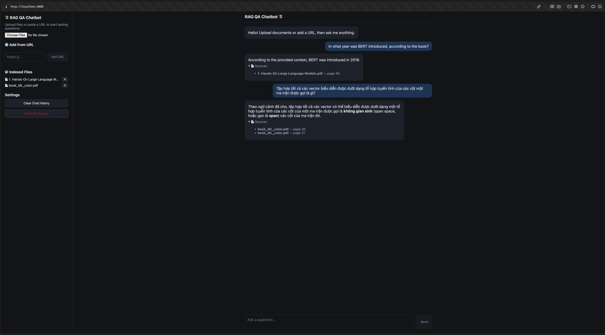

# LangChain-RAG-QA-Chatbot

[](https://github.com/hoaho1701/LangChain-RAG-QA-Chatbot/actions/workflows/ci.yml)

A local, privacy-first RAG (Retrieval-Augmented Generation) chatbot. Upload documents, ask questions in natural language, get answers grounded in your own files — with source citations, conversation memory, and a self-correcting **agentic retrieval loop**.

Powered by LangChain (Core/LCEL), LangGraph, and Ollama, with a FastAPI backend and a React frontend, this project runs **100% locally**: no API keys required, no data leaves your machine, no usage costs.



---

### ✨ Key Features

- **Agentic RAG (Corrective RAG):** A LangGraph state machine that grades retrieved documents for relevance and automatically rewrites the query and retries when nothing relevant is found.
- **Two-Stage Retrieval:** Bi-encoder similarity search (top-20 candidates) followed by cross-encoder reranking (top-5) for higher-precision context.
- **Conversation Memory:** Follow-up questions ("What about that?") are rewritten into standalone questions using chat history before retrieval.
- **Source Citations:** Every answer links back to the exact file and page it was derived from.
- **Multi-Format Ingestion:** PDF, TXT, Markdown, DOCX, and direct URL scraping — all through one dispatcher.
- **Multi-File Management:** Additive indexing — add or remove individual files without rebuilding the whole vector database.
- **Streaming Responses:** The API streams answers token-by-token over Server-Sent Events, and the React UI renders them as Markdown.
- **Evaluation Harness:** Retrieval metrics (Recall@k, MRR) and LLM-as-judge generation metrics (Correctness, Faithfulness), with a per-language breakdown. Runs can be logged to MLflow to compare configurations.
- **CI/CD:** GitHub Actions lints and tests the backend, lints and builds the frontend, and publishes Docker images to GHCR from `main`.

---

### 🛠️ Tech Stack

| Component            | Technology                                  |
| --------------------- | -------------------------------------------- |
| **Orchestration**     | LangChain Core (LCEL) + LangGraph            |
| **LLM**               | Ollama (`qwen3.5:9b`)                         |
| **Embedding Model**   | HuggingFace (`BAAI/bge-m3`)                   |
| **Reranker**          | Cross-Encoder (`BAAI/bge-reranker-v2-m3`)     |
| **Vector Database**   | ChromaDB (persistent, local)                  |
| **Backend**           | FastAPI + Server-Sent Events                  |
| **Frontend**          | React 19 + Vite, served by nginx              |
| **Experiment Tracking** | MLflow                                      |
| **Packaging / CI**    | uv, Docker Compose, GitHub Actions            |
| **Language**          | Python 3.10, JavaScript                       |

---

### 🧠 How It Works

```
React (Vite / nginx) ──/api──▶ FastAPI ──▶ RAGPipeline
                                  │           ├─ Ollama (runs on the host)
                                  │           └─ ChromaDB (data/vector_db/)
eval.evaluate ──▶ MLflow server
```

```
User question
    │
    ▼
[LangGraph agentic loop]
    ├── retrieve  → contextualize (if chat history) → top-20 → rerank → top-5
    ├── grade     → LLM checks which docs are actually relevant
    └── decide    ├── relevant docs found        → generate answer
                  └── none found (retry < 1)      → rewrite query → retrieve again
    ▼
Answer streamed token-by-token, with source citations (file + page)
```

---

### 📂 Project Structure

```
LangChain-RAG-QA-Chatbot/
├── api/
│   ├── main.py              # FastAPI app: documents, chat (SSE), health
│   └── schemas.py           # Request models
├── frontend/                # React + Vite app (Dockerfile + nginx.conf included)
├── src/
│   ├── config.py            # Constants + env vars
│   ├── prompts.py           # All ChatPromptTemplate definitions
│   ├── rag_pipeline.py      # RAGPipeline: ingestion, retrieval, agentic graph
│   ├── evaluation.py        # Retrieval + generation evaluation metrics
│   └── tracking.py          # Logs an evaluation run to MLflow
├── tests/                   # API tests (fake pipeline) + MLflow logging tests
├── eval/
│   ├── dataset.json         # 150 Q&A cases used by the evaluation
│   ├── evaluate.py          # CLI: run the evaluation harness (python -m eval.evaluate)
│   ├── build_index.py       # CLI: build the index the evaluation set expects (data/eval_index/)
│   ├── compare.py           # CLI: compare two evaluation runs question by question
│   ├── Report.md            # Committed snapshot of a real evaluation run
│   └── documents/           # The four documents of the evaluation set (gitignored)
├── Dockerfile.api           # Backend image
├── docker-compose.yml       # api + web + mlflow
├── .github/workflows/ci.yml # Lint, test, build, publish
├── data/                    # Everything the app and the evaluation write (gitignored)
│   ├── documents/           #   uploaded source files
│   ├── vector_db/           #   ChromaDB persistent storage
│   ├── eval_index/          #   index of the evaluation set (python -m eval.build_index)
│   └── mlruns/              #   MLflow runs of a local evaluation
├── pyproject.toml           # Dependencies (uv)
├── uv.lock                  # Locked versions
└── LICENSE
```

---

### 🚀 Installation and Setup

**Prerequisites:**
- [Ollama](https://ollama.com/) installed and running
- [uv](https://docs.astral.sh/uv/) (installs Python 3.10 for you)
- Node.js 22+ (only for the dev setup)
- Docker Desktop (only for the Docker setup)

**1. Pull the LLM and clone the repository**
```bash
ollama pull qwen3.5:9b
git clone https://github.com/hoaho1701/LangChain-RAG-QA-Chatbot
cd LangChain-RAG-QA-Chatbot
```

**2a. Run for development** (two terminals)
```bash
uv sync                                   # creates .venv from uv.lock

# Terminal 1 — backend. The first start downloads the embedding and reranker
# models (a few GB); later starts can run offline (HF_LOCAL_FILES_ONLY defaults to true).
HF_LOCAL_FILES_ONLY=false uv run uvicorn api.main:app --port 8000

# Terminal 2 — frontend (proxies /api to port 8000)
cd frontend && npm ci && npm run dev      # http://localhost:5173
```

**2b. Run with Docker Compose**
```bash
docker compose up --build
```
- App: http://localhost:8080
- MLflow: http://localhost:5001

Ollama keeps running on the host, and the containers reach it through `host.docker.internal`. The compose file mounts `~/.cache/huggingface`, so the models must already be in that cache (run the backend once as in 2a first).

The images published to GHCR are `linux/amd64` only. `docker compose up --build` builds for your own architecture; to run the published images on Apple Silicon, add `--platform linux/amd64` (they then run under emulation, which is slow).

---

### 📖 How to Use

1. **Add content:** Choose PDF/TXT/MD/DOCX files and click **"Process Documents"**, or paste a URL and click **"Add URL"**.
2. **Chat:** Ask a question in the chat box (Enter sends, Shift+Enter adds a new line). Follow-up questions are understood in context.
3. **Check sources:** Expand **"Sources"** under any answer to see the exact file and page it came from.
4. **Manage files:** Remove individual indexed files with ✕ in the sidebar without affecting the rest of the database.
5. **Reset:**
   - **Clear Chat History** — wipes the conversation only.
   - **Clear Workspace** — deletes all uploaded files and the vector database (requires confirmation).

Adding or removing documents starts a fresh conversation for the model; earlier messages stay on screen.

---

### 📊 Evaluating the Pipeline

```bash
uv run python -m eval.evaluate                          # uses eval/dataset.json by default
uv run python -m eval.evaluate --dataset eval/other.json --report eval/other_report.md
uv run python -m eval.evaluate --split test            # dev (default) to iterate on, test to confirm once, all for everything
uv run python -m eval.evaluate --per-case-json runs/a.json   # also save one record per question, to compare two runs case by case
uv run python -m eval.evaluate --mlflow                 # also log the run to MLflow
uv run python -m eval.evaluate --judge-model phi4:14b    # grade with another Ollama model (default: JUDGE_MODEL = gemma4:12b)
```

Runs every question of the chosen split (`dev` by default) through the retriever+reranker (Recall@k, MRR) and the full
agentic `chat()` pipeline (LLM-as-judge Correctness, Faithfulness), then prints a Markdown report
— with breakdowns by language, question type and split, and the median seconds per answer — and saves it to `eval/last_report.md`.

The dataset holds 150 questions about four documents: two books (the English *Hands-On Large Language Models* and the
Vietnamese *Machine Learning cơ bản*, both indexed in full) and two Wikipedia articles (English "Photosynthesis" and
Vietnamese "Biến đổi khí hậu"). There are twelve types: factoid, explanation, multi-hop (needs two passages), numbers,
comparison or list, paraphrase (worded unlike the text), distractor (a neighbouring passage holds a similar fact),
follow-up (needs the chat history), cross-language (a Vietnamese question about an English text and the other way
round), typos or no diacritics, tables/formulas/code, and out-of-document (the right answer is a refusal; these have no
retrieval metric). The answer in the language of the question is expected, whatever the language of the text.

Each question belongs to the `dev` split (49 questions, to iterate on) or the `test` split (101, to confirm once). The
split is stratified by type, document, language and position in the document, and questions about the same passage always
stay together. What a retrieved chunk must contain is stored as verbatim snippets rather than chunk positions, so
Recall@k still works after re-chunking; `eval.evaluate` stops if a snippet is in no indexed chunk. The `author` field says
how each question came about: all were drafted with an AI assistant and then read by a person, who accepted every one and
edited the wording of 26 answers. Differences of a point or two are noise on a set this size.

The four documents are not in the repository (the books are copyrighted): put them in `eval/documents/`, which git
ignores, each file named after the `doc` field of its questions.

| `doc` | File in `eval/documents/` | Language | What it is | Questions (dev / test) |
|---|---|---|---|---|
| `hands-on-llms` | `hands-on-llms.pdf` | English | Book *Hands-On Large Language Models* (428 pages), your own copy | 41 (13 / 28) |
| `ml-co-ban` | `ml-co-ban.pdf` | Vietnamese | Book *Machine Learning cơ bản* (400 pages), your own copy | 42 (13 / 29) |
| `photosynthesis-wikipedia` | `photosynthesis-wikipedia.txt` | English | [Wikipedia "Photosynthesis", revision 1379238357](https://en.wikipedia.org/w/index.php?title=Photosynthesis&oldid=1379238357) | 35 (12 / 23) |
| `bien-doi-khi-hau-wikipedia` | `bien-doi-khi-hau-wikipedia.txt` | Vietnamese | [Wikipedia "Biến đổi khí hậu", revision 75639568](https://vi.wikipedia.org/w/index.php?title=Biến_đổi_khí_hậu&oldid=75639568) | 32 (11 / 21) |

The Wikipedia files are the plain text of exactly those revisions, preceded by three header lines (page and revision, link,
license) and a blank line. The questions quote short passages word for word, so another revision will not match and
`eval.evaluate` will stop. Wikipedia text is under the [CC BY-SA 4.0](https://creativecommons.org/licenses/by-sa/4.0/)
license. Build the index the questions expect in a folder of its own, so the index of the app is never touched, and point
the evaluation at it:

```bash
uv run python -m eval.build_index                         # creates data/eval_index/ (about 2000 chunks, ~8 min on a CPU)
VECTOR_DB_PATH=data/eval_index uv run python -m eval.evaluate --split all
```

`eval.build_index` refuses to write into the vector database of the app or into a folder that already exists.

A separate judge model (`JUDGE_MODEL`, `gemma4:12b` by default; run `ollama pull gemma4:12b` first) grades the answers, so the answering model never grades itself. `--judge-model` picks another Ollama model for a cross-check, and an empty value makes the answering model grade itself. The judge and a hash of the judge prompts are logged to MLflow next to the QA prompt hash.

To compare two runs, save each with `--per-case-json` and run `uv run python -m eval.compare before.json after.json`. The questions are paired by id; for every metric the table gives the change, a 95% interval from a paired bootstrap, and how many questions got better or worse. An interval that contains 0 means the two runs cannot be told apart on this many questions.

With `--mlflow`, a hash of the dataset file and the split that ran are logged too, so runs on different questions are not compared by mistake. Set `MLFLOW_TRACKING_URI` to the server (for example `http://localhost:5001` when the compose stack is up); without it the run is written to `./data/mlruns`.

See [`eval/Report.md`](eval/Report.md) for a committed snapshot of a real run, on an earlier version of the question set
(72 questions about the first 80 book pages; it will be replaced by a run on the questions above)
(Recall@5 97%, MRR 0.89, Correctness 97%, Faithfulness 96%; on the 20 `test` questions Correctness 95% and Faithfulness 95%),
graded by `gemma4:12b` and cross-checked with `phi4:14b`. The questions were written with an AI assistant and the set is small, so differences of a point or two are noise.

---

### 🧪 Tests and CI

```bash
uv run pytest -q          # API tests run with a fake pipeline: no Ollama or models needed
uv run ruff check . && uv run ruff format --check .
cd frontend && npm test   # Vitest + Testing Library: the API client (SSE streaming, error messages) and the chat, sidebar and app behaviour, with the backend mocked
```

On every pull request GitHub Actions runs the backend lint and tests, the frontend lint, format check, tests and build, and a trial build of both Docker images. Pushes to `main` also publish the images to GitHub Container Registry.

---

### 🔮 Future Development

- [ ] **Multi-Modal:** Support asking questions about images/figures inside PDFs.
- [ ] **Persistent Chat History:** Keep conversations across page reloads.
- [ ] **Answer language:** Reply in the language of the question, and measure it with out-of-document questions in the evaluation set.

---

### 📄 License

This project is licensed under the **MIT License**. See the `LICENSE` file for more details.

---

### 🙏 Acknowledgements

This project would not have been possible without the amazing open-source tools from the community:
- [LangChain](https://www.langchain.com/) & [LangGraph](https://www.langchain.com/langgraph)
- [Ollama](https://ollama.com/)
- [ChromaDB](https://www.trychroma.com/)
- [FastAPI](https://fastapi.tiangolo.com/) & [React](https://react.dev/)
- [MLflow](https://mlflow.org/)
